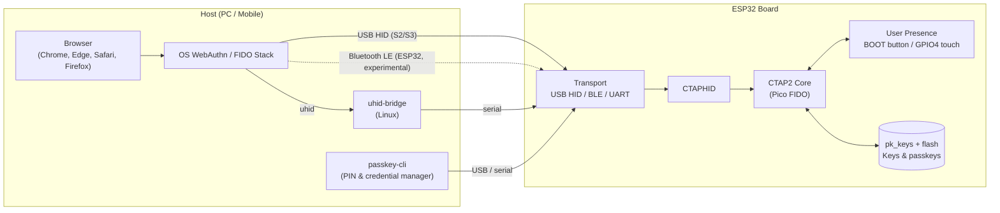
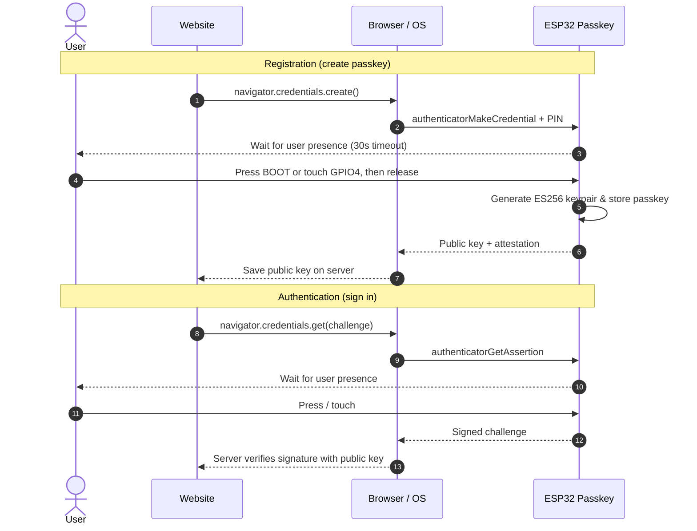
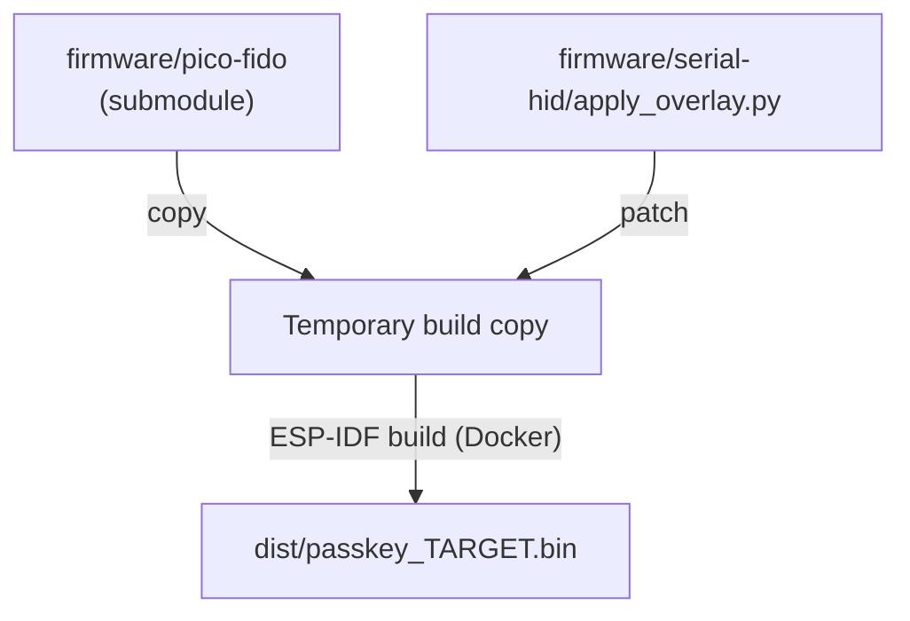

<div align="center">

# ESP32 Passkey

**Build and test an open-source FIDO2 / WebAuthn security key on an inexpensive ESP32 development board.**

English | [ภาษาไทย](README.th.md)

[](https://github.com/ffe111/esp32-passkey/actions/workflows/build.yml)
[](LICENSE)

[](#contributing)

[Why ESP32 Passkey?](#why-esp32-passkey) •
[How It Works](#how-it-works) •
[Board Compatibility](#board-compatibility) •
[Quick Start](#quick-start) •
[CLI Reference](#manage-passkeys-with-passkey-cli) •
[Roadmap](#roadmap)

</div>

<!-- Maintainers: Update the English README first, then mirror the change in README.th.md. -->

> [!WARNING]
> **Alpha software — read before using on critical accounts.**
> ESP32 chips do not have a hardware secure element like a commercial YubiKey. Anyone with physical access and flash-read capabilities could potentially extract stored keys. Read [docs/SECURITY.md](docs/SECURITY.md) before using this with high-value accounts.

---

## Why ESP32 Passkey?

Use an inexpensive ESP32 development board to learn how a hardware security key handles passkey registration and sign-in. No board yet? The project includes a software emulator for exploring the workflow.

**ESP32 Passkey** turns an ESP32 into a working FIDO2 / WebAuthn passkey powered by [Pico FIDO](https://github.com/polhenarejos/pico-fido) as the CTAP2 core, wrapped with everything needed to build, flash, test, and manage it effortlessly:

- **Zero ESP-IDF setup** — Build firmware for every supported chip with a single Docker command.
- **Free open-source CLI (`passkey-cli`)** — Set a PIN, list/delete passkeys, run self-tests, and factory-reset without paid companion apps.
- **Works even without native USB** — Supports classic ESP32, C3, and C6 over Serial, plus experimental **Bluetooth LE** on classic ESP32.
- **Enforced user presence** — Every registration and sign-in requires pressing **BOOT** or touching **GPIO4** (unlike stock Pico FIDO, which disables this check on ESP32).
- **Survives firmware updates** — Keys and PINs live in a dedicated partition that is not overwritten when flashing new firmware.
- **Testable without hardware** — Includes a Linux TCP emulator and Espressif QEMU CI tests.

---

## How It Works



- **Native-USB chips (`ESP32-S2`, `ESP32-S3`):** Act as a standard USB HID FIDO2 security key — plug and play across desktop and mobile.
- **USB-serial chips (`ESP32`, `ESP32-C3`, `ESP32-C6`):** Lack native USB device hardware, so they communicate over UART serial or Bluetooth LE instead.

### Registration & Sign-In Flow



Private keys never leave the board. Websites only receive the public key, and nothing is signed without physical confirmation.

---

## Board Compatibility

| Chip | Transport | Windows | macOS / iOS | Linux |
|---|---|---|---|---|
| **ESP32-S3** *(recommended)*, ESP32-S2 | Native USB HID security key (plug & play) | ✅ | ✅ (iOS via USB-C) | ✅ |
| Classic ESP32 (standard DevKit) | Bluetooth LE (experimental) | 🧪 Registration works | ❌ Apple blocks BLE keys | Untested |
| ESP32, ESP32-C3, ESP32-C6 | Serial via CP210x / CH340 | `passkey-cli` only | `passkey-cli` only | ✅ Browsers via `uhid-bridge` |

> **Tip:** If you want seamless browser sign-in across all operating systems, grab an **ESP32-S3** board (around $4–$7).

---

## Project Status

| Component | Status |
|---|---|
| CTAP2 core: create passkey, sign in, PIN, list/delete credentials, factory reset | ✅ Verified on real ESP32 hardware over serial |
| Security rules: lock after 8 wrong PINs; reset requires <10s after boot + touch | ✅ Verified on real hardware |
| User presence via capacitive touch on GPIO4 | ✅ Verified on real hardware |
| Linux emulator & QEMU tests (`esp32`, `esp32c3`) | ✅ Running in CI |
| Bluetooth LE on classic ESP32 | 🧪 Pairs & registers on Windows 11 (`webauthn.io`); sign-in not yet verified |
| Native USB security key on ESP32-S3 | ⏳ Builds cleanly; awaiting real-board testing |
| Web flasher & automated GitHub Releases | ⏳ Workflow ready; pending dedicated USB VID/PID |

---

## Quick Start


### 1. Build the Firmware (Docker only)

```bash
git clone --recursive https://github.com/ffe111/esp32-passkey.git
cd esp32-passkey
```

```powershell
powershell -File firmware/build.ps1 -Target esp32s3   # or esp32s2, esp32, esp32c3, esp32c6
```

On macOS / Linux, use `pwsh firmware/build.ps1 ...` or run `firmware/build.sh` inside the `espressif/idf:v5.5.4` container.
The compiled image is written to `dist/passkey_<target>.bin`.

### 2. Flash to Your Board

```bash
python -m esptool --chip esp32s3 --port COM5 write-flash 0x0 dist/passkey_esp32s3.bin
```

- If you see `Wrong boot mode detected`, hold the **BOOT** button while `Connecting...` appears.
- Flashing over an existing installation preserves your PIN and passkeys (`erase-flash` wipes everything).
- The browser-based flasher (`web-flasher/`, powered by ESP Web Tools) will go live on GitHub Pages once the first release is published.

### 3–4. Set a PIN and Run Self-Test

```bash
pip install ./tools/passkey-cli
passkey-cli pin set
passkey-cli selftest
```

For serial-based boards, pass `--device serial:COM3` (Windows) or `--device serial:/dev/ttyUSB0` (Linux).

---

## User Presence (Physical Confirmation)

Every credential creation and sign-in requires **pressing and releasing the BOOT button** within 30 seconds.
Holding the button for more than 15 seconds is rejected to prevent stuck buttons or shorted pins from auto-approving requests.

**Classic ESP32: Capacitive touch on GPIO4** — Some budget DevKits do not wire the BOOT button for runtime reads:

- Touch the bare metal **GPIO4** pin (often labeled `D4` or `IO4`) with a fingertip for ~1 second, then release.
- Fingernails or plastic will not trigger it; if the board is on a breadboard, attach a jumper wire to `D4` and touch the exposed metal tip.
- **Do not touch GPIO4 while plugging in or resetting** — the firmware calibrates the baseline at boot.
- Keep other circuitry disconnected from GPIO4.

---

## Bluetooth LE (Experimental, Classic ESP32)

Turn a standard ESP32 DevKit into a wireless passkey without buying an ESP32-S3:

```powershell
powershell -File firmware/build.ps1 -Target esp32 -Ble   # outputs dist/passkey_esp32_ble.bin
```

1. Flash the firmware, then open Windows **Settings > Bluetooth & devices > Add device > Bluetooth**.
2. Pair with **ESP32 Passkey**.
3. In your browser, choose **Security key** and touch **GPIO4** when prompted.

Current limitations:

- Reflashing firmware clears pairing bonds — remove the device in Windows and re-pair after flashing.
- Uses *Just Works* pairing (anyone nearby can pair, though PIN + touch are still required for every FIDO2 operation).
- macOS and iOS do not support BLE security keys.

---

## Linux Browser Support over Serial

```bash
sudo python3 tools/uhid-bridge/uhid_bridge.py serial:/dev/ttyUSB0
```

Exposes a virtual USB HID security key via `uhid` so Chrome and Firefox can use serial-only ESP32 boards directly.

---

## Manage Passkeys with `passkey-cli`

```bash
passkey-cli list                      # Discover connected devices
passkey-cli info                      # Show authenticator capabilities & status
passkey-cli pin set                   # Set a PIN (recommended right after flashing)
passkey-cli selftest                  # Run end-to-end registration + assertion test
passkey-cli creds list                # List stored passkeys
passkey-cli creds delete <id>         # Delete a specific passkey
passkey-cli reset                     # Factory-reset all keys (within 10s of boot)
```

See [tools/passkey-cli/README.md](tools/passkey-cli/README.md) for full usage details.

---

## Project Structure

```text
firmware/pico-fido/     Upstream Pico FIDO (git submodule, unmodified)
firmware/build.sh|ps1   Dockerized build scripts using espressif/idf:v5.5.4
firmware/serial-hid/    Overlay patching a temp copy: UART, BLE, touch, key partition
tools/passkey-cli/      Python CLI manager (built on python-fido2)
tools/uhid-bridge/      Linux bridge: serial -> virtual USB FIDO2 key
emulator/               Linux Pico FIDO emulator & QEMU scripts for hardware-free CI
web-flasher/            Browser-based flasher (ESP Web Tools)
docs/SECURITY.md        Threat model & hardware security limitations
```



The overlay only patches a temporary copy — never the submodule directly — and every patch site enforces an exact single match so upstream changes fail loudly instead of silently producing broken firmware.

---

## Testing & Debugging

```bash
pytest tools/passkey-cli/tests                  # Unit tests

# Linux Pico FIDO emulator (TCP)
docker build -f emulator/Dockerfile -t esp32-passkey-emulator .
docker run -d --rm --name emu -p 35962:35962 esp32-passkey-emulator
PASSKEY_DEVICE=tcp:127.0.0.1:35962 pytest tools/passkey-cli/tests/test_e2e_emulator.py

# Real hardware over serial (press/touch when prompted ">>> Tap BOOT ... <<<")
PASSKEY_DEVICE=serial:COM3 pytest -v tools/passkey-cli/tests/test_e2e_emulator.py
```

QEMU serial tests require the `-NoButton` build (never use `-NoButton` in real life). See [.github/workflows/build.yml](.github/workflows/build.yml) for the exact CI commands.

Debugging serial firmware on real hardware:

```powershell
powershell -File firmware/build.ps1 -Target esp32 -SerialDebug   # outputs dist/passkey_esp32_debug.bin
$env:PASSKEY_TRACE = '1'; passkey-cli --device serial:COM3 selftest
```

---

## Roadmap

- [ ] Test native USB security key mode on real **ESP32-S3** hardware
- [ ] BLE: verify sign-in flow, persist pairing bonds across firmware updates, test on Linux
- [ ] Register a dedicated USB VID/PID via [pid.codes](https://pid.codes) and enable automated releases + Web Flasher
- [ ] Hardened release mode with flash encryption and secure boot
- [ ] Package `passkey-cli` as standalone `.exe` / `.app` binaries
- [x] Bilingual documentation ([English](README.md) & [ภาษาไทย](README.th.md))
- [ ] Community-tested board compatibility list

---

## Contributing

Contributions, bug reports, and **hardware test reports** are very welcome!
If you test this firmware on a board or OS not yet marked ✅ in the [Board Compatibility](#board-compatibility) table, please open an issue or PR with your results.

- Found this useful? Give the repo a **Star** to help others discover it.
- Found a security vulnerability? Please report it privately via **GitHub Security Advisories** instead of opening a public issue.

---

## Binary Distribution Notice

Per Pico FIDO's README, pre-built binaries must not be distributed using someone else's USB VID/PID.
Before publishing public releases, obtain a free PID from [pid.codes](https://pid.codes) and configure `USB_VID` / `USB_PID` in repository variables.

---

## License & Credits

Licensed under **AGPL-3.0** (same as Pico FIDO) — see [LICENSE](LICENSE).

- [Pico FIDO](https://github.com/polhenarejos/pico-fido) & `pico-keys-sdk` by Pol Henarejos — CTAP2 core
- [python-fido2](https://github.com/Yubico/python-fido2) by Yubico — powers `passkey-cli`
- [ESP-IDF](https://github.com/espressif/esp-idf) & NimBLE — Espressif SDK and Bluetooth stack
