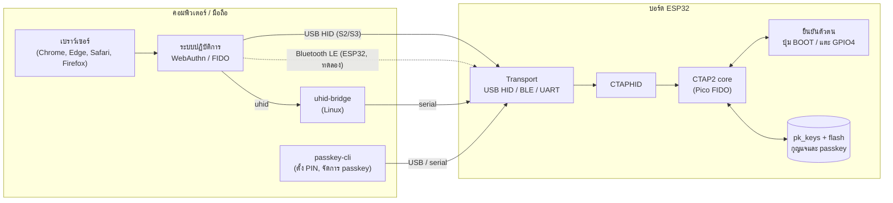
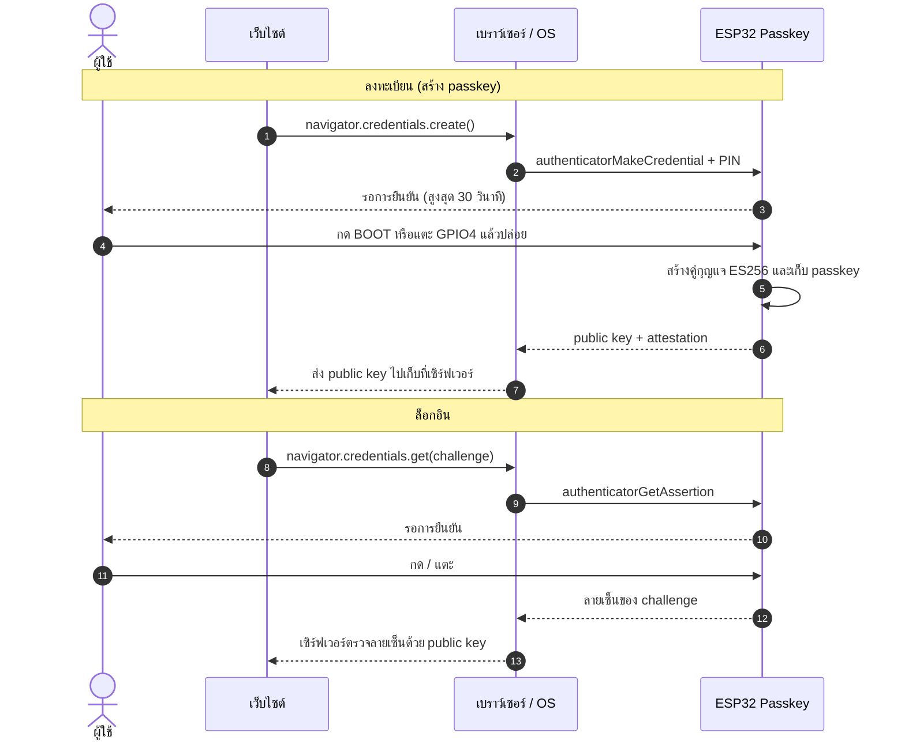
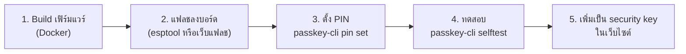
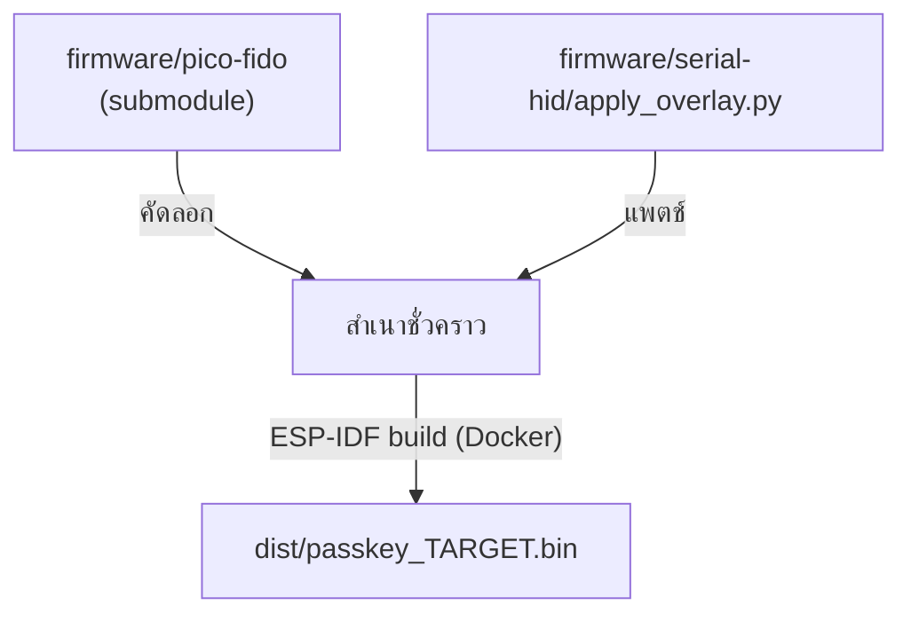

<div align="center">

# ESP32 Passkey

**Passkey (FIDO2 / WebAuthn security key) ราคาหลักร้อย ทำจากบอร์ด ESP32 โอเพนซอร์สทั้งหมด**

*A cheap, open-source FIDO2 passkey you build from an ESP32 board.*

[](https://github.com/ffe111/esp32-passkey/actions/workflows/build.yml)
[](LICENSE)


</div>

> [!WARNING]
> โปรเจกต์นี้ยังเป็นรุ่นทดลอง (alpha) ESP32 ไม่มี secure element แบบ YubiKey
> ใครที่ได้ตัวบอร์ดไปและอ่าน flash ได้ อาจดึงกุญแจออกมาได้ อ่าน [docs/SECURITY.md](docs/SECURITY.md) ก่อนใช้กับบัญชีสำคัญ

## ทำไมต้องโปรเจกต์นี้

Security key ทั่วไปราคาเป็นพันบาท ส่วน ESP32 ราคาไม่กี่ร้อยบาทและหาซื้อง่าย
โปรเจกต์นี้เปลี่ยน ESP32 ให้เป็น passkey ที่ใช้ล็อกอินเว็บไซต์ได้ โดยใช้เฟิร์มแวร์ [Pico FIDO](https://github.com/polhenarejos/pico-fido) เป็นแกน CTAP2
แล้วเพิ่มส่วนที่ทำให้ใช้งานจริงได้ง่ายขึ้น:

- **ไม่ต้องติดตั้ง ESP-IDF** build ทุกชิปด้วย Docker คำสั่งเดียว
- **แอปจัดการฟรี** `passkey-cli` ตั้ง PIN ดูและลบ passkey ล้างอุปกรณ์ได้ ไม่ต้องซื้อแอปเสริม
- **รองรับ ESP32 ที่ไม่มี USB ในตัว** ผ่าน serial และ Bluetooth LE (ทดลอง)
- **ต้องยืนยันตัวตนเสมอ** ทุกครั้งที่สร้าง passkey หรือล็อกอินต้องกดปุ่ม BOOT หรือแตะขา GPIO4
  (Pico FIDO ต้นฉบับปิดการเช็กนี้ไว้)
- **อัปเดตเฟิร์มแวร์แล้ว passkey ไม่หาย** กุญแจอยู่ในพาร์ทิชันแยกที่การแฟลชไม่ทับ
- **ทดสอบได้โดยไม่มีบอร์ด** ทั้งด้วย emulator และ QEMU ของ Espressif ใน CI

## ทำงานอย่างไร



ชิปที่มี USB ในตัว (ESP32-S2/S3) เป็น USB security key ได้เลย ระบบปฏิบัติการมองเห็นเหมือน YubiKey
ชิปที่มีแค่ชิป USB-serial บนบอร์ด (ESP32 รุ่นแรก, C3, C6) เป็นอุปกรณ์ USB HID เองไม่ได้
จึงคุยกับคอมผ่าน serial หรือ Bluetooth แทน

### ลำดับการสร้าง passkey และล็อกอิน



กุญแจส่วนตัวไม่เคยออกจากบอร์ด เว็บไซต์เก็บแค่ public key และถ้าไม่มีการกดหรือแตะ บอร์ดจะไม่เซ็นอะไรให้

## เลือกบอร์ด

| ชิป | ใช้เป็น passkey แบบไหน | Windows | macOS / iOS | Linux |
|---|---|---|---|---|
| **ESP32-S3** (แนะนำ), ESP32-S2 | USB security key เสียบแล้วใช้ได้เลย | ✅ | ✅ (iOS ผ่าน USB-C) | ✅ |
| ESP32 รุ่นแรก (DevKit ทั่วไป) | Bluetooth LE (ทดลอง) | 🧪 ลงทะเบียนได้แล้ว | ❌ Apple ไม่รองรับ key แบบ BLE | ยังไม่ได้ทดสอบ |
| ESP32, ESP32-C3, ESP32-C6 | serial ผ่านชิป CP210x/CH340 | `passkey-cli` เท่านั้น | `passkey-cli` เท่านั้น | ✅ เบราว์เซอร์ผ่าน `uhid-bridge` |

ถ้าต้องการล็อกอินเว็บได้ทุกระบบ ให้ใช้ **ESP32-S3** (ราคาประมาณ 150–250 บาท)

## สถานะ

| ส่วน | สถานะ |
|---|---|
| CTAP2: สร้าง passkey, ล็อกอิน, PIN, ดู/ลบ passkey, reset | ✅ ทดสอบบนบอร์ด ESP32 จริงผ่าน serial |
| PIN ผิด 8 ครั้งแล้วล็อก, reset ต้องทำภายใน 10 วินาทีหลังบูตและต้องแตะยืนยัน | ✅ ทดสอบบนบอร์ดจริง |
| ยืนยันตัวตนด้วยการแตะ GPIO4 | ✅ ทดสอบบนบอร์ดจริง |
| Emulator และ QEMU (ESP32, ESP32-C3) | ✅ รันใน CI |
| Bluetooth LE บน ESP32 รุ่นแรก | 🧪 Windows 11 จับคู่และสร้าง passkey ที่ webauthn.io ได้ ส่วนการล็อกอินยังยืนยันไม่ได้ |
| USB security key บน ESP32-S3 | ⏳ build ผ่าน แต่ยังไม่ได้ทดสอบกับบอร์ดจริง |
| เว็บแฟลชและ release อัตโนมัติ | ⏳ มี workflow แล้ว รอ VID/PID ของตัวเอง |

## เริ่มใช้งาน



### 1. Build เฟิร์มแวร์ (ต้องมีแค่ Docker)

```bash
git clone --recursive https://github.com/ffe111/esp32-passkey.git
cd esp32-passkey
```

```powershell
powershell -File firmware/build.ps1 -Target esp32s3   # หรือ esp32s2, esp32, esp32c3, esp32c6
```

บน macOS / Linux ใช้ `pwsh firmware/build.ps1 ...` หรือเรียก `firmware/build.sh` ใน container `espressif/idf:v5.5.4`
ได้ไฟล์ `dist/passkey_<target>.bin`

### 2. แฟลชลงบอร์ด

```bash
python -m esptool --chip esp32s3 --port COM5 write-flash 0x0 dist/passkey_esp32s3.bin
```

- ถ้าขึ้น `Wrong boot mode detected` ให้กดปุ่ม **BOOT** ค้างไว้ตอนที่ขึ้น `Connecting...`
- แฟลชทับของเดิมได้เลย PIN และ passkey ยังอยู่ ส่วน `erase-flash` จะล้างทุกอย่าง
- เว็บแฟลช (`web-flasher/`, ESP Web Tools) จะเปิดบน GitHub Pages เมื่อมี release แรก

### 3–4. ตั้ง PIN และทดสอบ

```bash
pip install ./tools/passkey-cli
passkey-cli pin set
passkey-cli selftest
```

บอร์ดที่ใช้ serial ให้เติม `--device serial:COM3` (Windows) หรือ `--device serial:/dev/ttyUSB0` (Linux)

## การยืนยันตัวตน (user presence)

ทุกครั้งที่สร้าง passkey หรือล็อกอิน ต้อง **กดปุ่ม BOOT แล้วปล่อย** ภายใน 30 วินาที
ถ้ากดค้างเกิน 15 วินาทีจะถูกปฏิเสธ เพื่อกันกรณีปุ่มค้างหรือขาลัดวงจรแล้วอนุมัติเอง

**ESP32 รุ่นแรก: แตะขา GPIO4 แทนปุ่มได้** บอร์ดราคาถูกบางรุ่นใช้ปุ่ม BOOT ไม่ได้ตอนเครื่องทำงาน

- แตะขา **GPIO4** (บนบอร์ดมักเขียนว่า D4 หรือ IO4) ด้วยปลายนิ้วประมาณ 1 วินาทีแล้วปล่อย
- ต้องโดนโลหะเปล่าของขา เล็บหรือพลาสติกไม่นับ
- ถ้าบอร์ดเสียบอยู่ใน breadboard ให้ต่อสายจัมเปอร์ที่ D4 แล้วแตะปลายโลหะของสาย
- **อย่าแตะขานี้ตอนเสียบสายหรือรีเซ็ต** เฟิร์มแวร์วัดค่าอ้างอิงตอนบูต
- อย่าต่อวงจรอื่นไว้ที่ GPIO4

## Bluetooth LE (ทดลอง, ESP32 รุ่นแรก)

ทำให้ ESP32 DevKit ทั่วไปเป็น passkey แบบไร้สายได้โดยไม่ต้องซื้อ ESP32-S3

```powershell
powershell -File firmware/build.ps1 -Target esp32 -Ble   # ได้ dist/passkey_esp32_ble.bin
```

1. แฟลชเฟิร์มแวร์ แล้วเปิด Windows **Settings > Bluetooth & devices > Add device > Bluetooth**
2. เลือก **ESP32 Passkey** เพื่อจับคู่
3. ในเบราว์เซอร์ เลือก **Security key** แล้วแตะ GPIO4 เมื่อถูกถาม

ข้อจำกัดตอนนี้:

- ทุกครั้งที่แฟลชเฟิร์มแวร์ใหม่ ข้อมูลการจับคู่จะหาย ต้อง Remove device ใน Windows แล้วจับคู่ใหม่
- จับคู่แบบ Just Works ใครอยู่ใกล้ก็จับคู่ได้ แต่ยังต้องแตะยืนยันและใส่ PIN ทุกครั้ง
- macOS และ iOS ไม่รองรับ security key แบบ BLE

## ใช้กับเบราว์เซอร์บน Linux ผ่าน serial

```bash
sudo python3 tools/uhid-bridge/uhid_bridge.py serial:/dev/ttyUSB0
```

สร้าง security key เสมือนให้ Chrome และ Firefox มองเห็น

## จัดการ passkey ด้วย passkey-cli

```bash
passkey-cli list                      # ดูอุปกรณ์
passkey-cli info                      # ข้อมูล authenticator
passkey-cli pin set                   # ตั้ง PIN (ควรทำทันที)
passkey-cli selftest                  # ลงทะเบียน + ล็อกอินทดสอบ
passkey-cli creds list                # ดู passkey ที่เก็บไว้
passkey-cli creds delete <id>         # ลบ passkey
passkey-cli reset                     # ล้างทุกอย่าง (ภายใน 10 วินาทีหลังเสียบ)
```

ดูรายละเอียดเพิ่มที่ [tools/passkey-cli/README.md](tools/passkey-cli/README.md)

## โครงสร้างโปรเจกต์

```
firmware/pico-fido/     Pico FIDO ต้นฉบับ (git submodule, ไม่แก้ไขโดยตรง)
firmware/build.sh|ps1   build ใน Docker image espressif/idf:v5.5.4
firmware/serial-hid/    overlay ที่แพตช์สำเนาของ Pico FIDO: UART, BLE, touch, พาร์ทิชันกุญแจ
tools/passkey-cli/      แอปจัดการ (Python, python-fido2)
tools/uhid-bridge/      Linux bridge: serial -> virtual USB FIDO key
emulator/               Pico FIDO emulator และสคริปต์ QEMU สำหรับทดสอบโดยไม่มีบอร์ด
web-flasher/            หน้าเว็บแฟลช (ESP Web Tools)
docs/SECURITY.md        โมเดลความปลอดภัยและข้อจำกัด
```



Overlay แพตช์เฉพาะสำเนา ไม่แก้ submodule และทุกจุดที่แพตช์ต้องเจอข้อความต้นฉบับครั้งเดียวพอดี
ถ้า upstream เปลี่ยน build จะหยุดทันทีแทนที่จะได้เฟิร์มแวร์แปลก ๆ

## ทดสอบ

```bash
pytest tools/passkey-cli/tests                  # unit tests

# Pico FIDO แบบโปรแกรม Linux (TCP)
docker build -f emulator/Dockerfile -t esp32-passkey-emulator .
docker run -d --rm --name emu -p 35962:35962 esp32-passkey-emulator
PASSKEY_DEVICE=tcp:127.0.0.1:35962 pytest tools/passkey-cli/tests/test_e2e_emulator.py

# บอร์ดจริงผ่าน serial: กดหรือแตะเมื่อขึ้น ">>> Tap BOOT ... <<<"
PASSKEY_DEVICE=serial:COM3 pytest -v tools/passkey-cli/tests/test_e2e_emulator.py
```

ทดสอบเฟิร์มแวร์ serial ใน QEMU ต้องใช้ build ที่ไม่เช็กปุ่ม (`-NoButton`, ห้ามใช้งานจริง)
ดูคำสั่งเต็มใน [.github/workflows/build.yml](.github/workflows/build.yml)

หาสาเหตุปัญหาบนบอร์ดแบบ serial:

```powershell
powershell -File firmware/build.ps1 -Target esp32 -SerialDebug   # ได้ dist/passkey_esp32_debug.bin
$env:PASSKEY_TRACE = '1'; passkey-cli --device serial:COM3 selftest
```

## Roadmap

- [ ] ทดสอบ ESP32-S3 แบบ USB security key กับบอร์ดจริง
- [ ] BLE: ยืนยันการล็อกอิน, เก็บข้อมูลการจับคู่ในพาร์ทิชันที่การแฟลชไม่ทับ, ทดสอบบน Linux
- [ ] ขอ VID/PID ของโปรเจกต์จาก [pid.codes](https://pid.codes) แล้วเปิด release และเว็บแฟลช
- [ ] โหมด release ที่เปิด flash encryption และ secure boot
- [ ] แพ็ก `passkey-cli` เป็น .exe / .app
- [ ] คู่มือภาษาอังกฤษ และรายชื่อบอร์ดที่ทดสอบแล้ว

## ร่วมพัฒนา

ยินดีรับ issue และ pull request โดยเฉพาะผลทดสอบกับบอร์ดและระบบปฏิบัติการที่ยังไม่อยู่ในตาราง
ถ้าพบช่องโหว่ด้านความปลอดภัย กรุณาแจ้งแบบส่วนตัวผ่าน GitHub Security Advisories แทนการเปิด issue สาธารณะ

## ข้อควรรู้ก่อนแจกไบนารี

README ของ Pico FIDO ห้ามแจกไบนารีที่ใช้ VID/PID ที่ไม่ใช่ของตัวเอง
ก่อน release ต้องขอ PID ฟรีจาก [pid.codes](https://pid.codes) แล้วตั้งตัวแปร `USB_VID` / `USB_PID` ใน GitHub

## License และเครดิต

AGPL-3.0 เหมือน Pico FIDO ดู [LICENSE](LICENSE)

- [Pico FIDO](https://github.com/polhenarejos/pico-fido) และ pico-keys-sdk โดย Pol Henarejos: แกน CTAP2
- [python-fido2](https://github.com/Yubico/python-fido2) โดย Yubico: ใช้ใน `passkey-cli`
- [ESP-IDF](https://github.com/espressif/esp-idf) และ NimBLE: SDK และ Bluetooth stack
