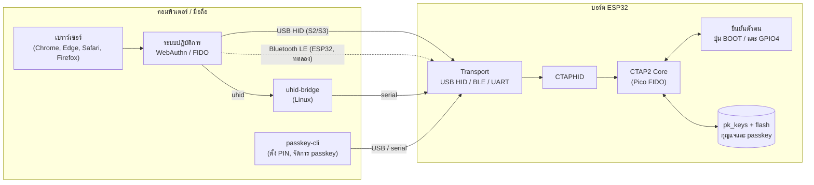
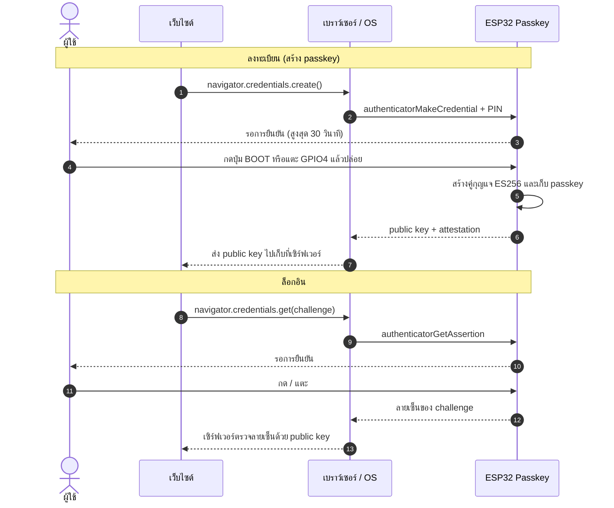
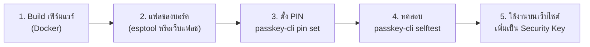
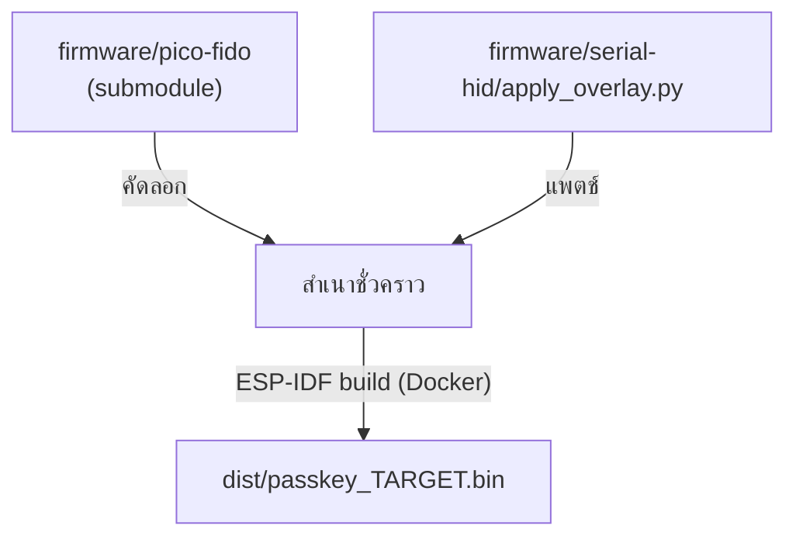

<div align="center">

# ESP32 Passkey

**สร้างและทดสอบกุญแจความปลอดภัย FIDO2 / WebAuthn แบบโอเพนซอร์สบนบอร์ดพัฒนา ESP32 ราคาประหยัด**

[English](README.md) | ภาษาไทย

[](https://github.com/ffe111/esp32-passkey/actions/workflows/build.yml)
[](LICENSE)

[](#ร่วมพัฒนา)

[ทำไมต้องโปรเจกต์นี้](#ทำไมต้องโปรเจกต์นี้) •
[ทำงานอย่างไร](#ทำงานอย่างไร) •
[เลือกบอร์ด](#เลือกบอร์ด) •
[เริ่มใช้งาน](#เริ่มใช้งาน) •
[คำสั่ง passkey-cli](#จัดการ-passkey-ด้วย-passkey-cli) •
[Roadmap](#roadmap)

</div>

> [!WARNING]
> **ซอฟต์แวร์รุ่นทดลอง (alpha) — โปรดอ่านก่อนใช้กับบัญชีสำคัญ**
> ชิป ESP32 ไม่มี secure element แบบ YubiKey ใครที่ได้ตัวบอร์ดไปและอ่านข้อมูลจาก flash ได้ อาจดึงกุญแจออกมาได้ อ่าน [docs/SECURITY.md](docs/SECURITY.md) ก่อนนำไปใช้กับบัญชีที่สำคัญ

---

## ทำไมต้องโปรเจกต์นี้

ใช้บอร์ด ESP32 ราคาประหยัดเพื่อเรียนรู้ว่ากุญแจความปลอดภัยแบบฮาร์ดแวร์สร้าง passkey และใช้ลงชื่อเข้าใช้อย่างไร หากยังไม่มีบอร์ด โปรเจกต์มีอีมูเลเตอร์ให้ลองขั้นตอนเหล่านี้ได้

**ESP32 Passkey** เปลี่ยน ESP32 ให้เป็น passkey ที่ใช้ล็อกอินเว็บไซต์ได้จริง โดยใช้เฟิร์มแวร์ [Pico FIDO](https://github.com/polhenarejos/pico-fido) เป็นแกน CTAP2 แล้วเพิ่มเครื่องมือที่ช่วยให้ build แฟลช ทดสอบ และจัดการได้ง่าย:

- **ไม่ต้องติดตั้ง ESP-IDF** — build เฟิร์มแวร์ได้ครบทุกชิปด้วย Docker คำสั่งเดียว
- **CLI จัดการฟรี (`passkey-cli`)** — ตั้ง PIN ดู/ลบ passkey ทดสอบตัวเอง และล้างอุปกรณ์ได้โดยไม่ต้องซื้อแอปเสริม
- **รองรับบอร์ดที่ไม่มี USB ในตัว** — ใช้งาน ESP32 รุ่นแรก, C3 และ C6 ผ่าน Serial รวมถึง **Bluetooth LE** (ทดลอง) บน ESP32 รุ่นแรก
- **บังคับยืนยันตัวตนเสมอ** — ทุกครั้งที่สร้าง passkey หรือล็อกอินต้องกดปุ่ม **BOOT** หรือแตะขา **GPIO4** (Pico FIDO ต้นฉบับปิดการเช็กนี้ไว้บน ESP32)
- **อัปเดตเฟิร์มแวร์แล้ว passkey ไม่หาย** — กุญแจและ PIN อยู่ในพาร์ทิชันแยกที่ไม่ถูกเขียนทับตอนแฟลช
- **ทดสอบได้โดยไม่มีบอร์ด** — มี emulator บน Linux และชุดทดสอบ QEMU ของ Espressif ใน CI

---

## ทำงานอย่างไร



- **ชิปที่มี USB ในตัว (`ESP32-S2`, `ESP32-S3`):** ทำงานเป็น USB HID FIDO2 security key มาตรฐาน เสียบแล้วใช้งานได้ทันที
- **ชิปที่ใช้ USB-serial (`ESP32`, `ESP32-C3`, `ESP32-C6`):** ไม่มีฮาร์ดแวร์ USB device ในตัว จึงสื่อสารผ่าน UART serial หรือ Bluetooth LE แทน

### ลำดับการสร้าง passkey และล็อกอิน



กุญแจส่วนตัวไม่เคยออกจากบอร์ด เว็บไซต์ได้รับแค่ public key และบอร์ดจะไม่เซ็นข้อมูลใด ๆ หากไม่มีการกดหรือแตะยืนยัน

---

## เลือกบอร์ด

| ชิป | รูปแบบการใช้งาน | Windows | macOS / iOS | Linux |
|---|---|---|---|---|
| **ESP32-S3** *(แนะนำ)*, ESP32-S2 | USB HID security key เสียบแล้วใช้ได้เลย | ✅ | ✅ (iOS ผ่าน USB-C) | ✅ |
| ESP32 รุ่นแรก (DevKit ทั่วไป) | Bluetooth LE (ทดลอง) | 🧪 ลงทะเบียนได้แล้ว | ❌ Apple ไม่รองรับ key แบบ BLE | ยังไม่ได้ทดสอบ |
| ESP32, ESP32-C3, ESP32-C6 | Serial ผ่านชิป CP210x / CH340 | `passkey-cli` เท่านั้น | `passkey-cli` เท่านั้น | ✅ เบราว์เซอร์ผ่าน `uhid-bridge` |

> **แนะนำ:** ถ้าต้องการล็อกอินเว็บไซต์ได้ครบทุกระบบปฏิบัติการ ให้ใช้บอร์ด **ESP32-S3** (ราคาประมาณ 150–250 บาท)

---

## สถานะโปรเจกต์

| ส่วนประกอบ | สถานะ |
|---|---|
| แกน CTAP2: สร้าง passkey, ล็อกอิน, PIN, ดู/ลบ passkey, reset | ✅ ทดสอบบนบอร์ด ESP32 จริงผ่าน serial แล้ว |
| กฎความปลอดภัย: ล็อกเมื่อใส่ PIN ผิด 8 ครั้ง, reset ต้องทำภายใน 10 วินาทีหลังบูตและต้องแตะยืนยัน | ✅ ทดสอบบนบอร์ดจริงแล้ว |
| ยืนยันตัวตนด้วยการแตะขา GPIO4 | ✅ ทดสอบบนบอร์ดจริงแล้ว |
| Emulator และชุดทดสอบ QEMU (`esp32`, `esp32c3`) | ✅ รันใน CI แล้ว |
| Bluetooth LE บน ESP32 รุ่นแรก | 🧪 Windows 11 จับคู่และสร้าง passkey ที่ `webauthn.io` ได้ ส่วนการล็อกอินยังรอการยืนยัน |
| USB security key บน ESP32-S3 | ⏳ build ผ่านแล้ว รอทดสอบกับบอร์ดจริง |
| เว็บแฟลชและ GitHub Release อัตโนมัติ | ⏳ มี workflow แล้ว รอ VID/PID ของโปรเจกต์เอง |

---

## เริ่มใช้งาน



### 1. Build เฟิร์มแวร์ (ต้องมีแค่ Docker)

```bash
git clone --recursive https://github.com/ffe111/esp32-passkey.git
cd esp32-passkey
```

```powershell
powershell -File firmware/build.ps1 -Target esp32s3   # หรือ esp32s2, esp32, esp32c3, esp32c6
```

บน macOS / Linux ใช้ `pwsh firmware/build.ps1 ...` หรือเรียก `firmware/build.sh` ใน container `espressif/idf:v5.5.4`
ไฟล์ที่ได้จะอยู่ที่ `dist/passkey_<target>.bin`

### 2. แฟลชลงบอร์ด

```bash
python -m esptool --chip esp32s3 --port COM5 write-flash 0x0 dist/passkey_esp32s3.bin
```

- ถ้าขึ้น `Wrong boot mode detected` ให้กดปุ่ม **BOOT** ค้างไว้ตอนที่ขึ้น `Connecting...`
- แฟลชทับของเดิมได้เลย PIN และ passkey จะยังอยู่ (ส่วน `erase-flash` จะล้างข้อมูลทั้งหมด)
- เว็บแฟลช (`web-flasher/` ด้วย ESP Web Tools) จะเปิดใช้งานบน GitHub Pages เมื่อมี release แรก

### 3–4. ตั้ง PIN และทดสอบตัวเอง

```bash
pip install ./tools/passkey-cli
passkey-cli pin set
passkey-cli selftest
```

สำหรับบอร์ดที่ใช้ serial ให้เติม `--device serial:COM3` (Windows) หรือ `--device serial:/dev/ttyUSB0` (Linux)

---

## การยืนยันตัวตน (User Presence)

ทุกครั้งที่สร้าง passkey หรือล็อกอิน ต้อง **กดปุ่ม BOOT แล้วปล่อย** ภายใน 30 วินาที
หากกดค้างเกิน 15 วินาทีระบบจะปฏิเสธ เพื่อป้องกันกรณีปุ่มค้างหรือขาลัดวงจรแล้วอนุมัติคำขอเอง

**ESP32 รุ่นแรก: แตะขา GPIO4 แทนปุ่มได้** — บอร์ดราคาประหยัดบางรุ่นอ่านปุ่ม BOOT ตอนเครื่องทำงานไม่ได้:

- แตะขา **GPIO4** (บนบอร์ดมักเขียนว่า `D4` หรือ `IO4`) ด้วยปลายนิ้วประมาณ 1 วินาทีแล้วปล่อย
- ต้องสัมผัสโดนโลหะเปลือยของขา (เล็บหรือพลาสติกไม่นับ) หากเสียบบอร์ดบน breadboard ให้ต่อสายจัมเปอร์ที่ `D4` แล้วแตะปลายโลหะของสาย
- **ห้ามแตะขานี้ตอนเสียบสายหรือรีเซ็ต** เพราะเฟิร์มแวร์ใช้วัดค่าอ้างอิงตอนบูต
- อย่าต่อวงจรอื่นไว้ที่ GPIO4

---

## Bluetooth LE (ทดลอง, ESP32 รุ่นแรก)

ทำให้ ESP32 DevKit ทั่วไปเป็น passkey แบบไร้สายได้โดยไม่ต้องซื้อ ESP32-S3:

```powershell
powershell -File firmware/build.ps1 -Target esp32 -Ble   # ได้ไฟล์ dist/passkey_esp32_ble.bin
```

1. แฟลชเฟิร์มแวร์ แล้วเปิด Windows **Settings > Bluetooth & devices > Add device > Bluetooth**
2. เลือกจับคู่กับ **ESP32 Passkey**
3. ในเบราว์เซอร์ เลือก **Security key** แล้วแตะ **GPIO4** เมื่อถูกถาม

ข้อจำกัดปัจจุบัน:

- ทุกครั้งที่แฟลชเฟิร์มแวร์ใหม่ ข้อมูลการจับคู่จะหาย ต้อง Remove device ใน Windows แล้วจับคู่ใหม่
- จับคู่แบบ *Just Works* (อุปกรณ์ใกล้เคียงจับคู่ได้ แต่ทุกคำสั่ง FIDO2 ยังต้องใส่ PIN และแตะยืนยันเสมอ)
- macOS และ iOS ไม่รองรับ security key แบบ BLE

---

## ใช้กับเบราว์เซอร์บน Linux ผ่าน Serial

```bash
sudo python3 tools/uhid-bridge/uhid_bridge.py serial:/dev/ttyUSB0
```

จำลอง security key เสมือนผ่าน `uhid` เพื่อให้ Chrome และ Firefox มองเห็นบอร์ด ESP32 แบบ serial ได้โดยตรง

---

## จัดการ passkey ด้วย `passkey-cli`

```bash
passkey-cli list                      # ค้นหาอุปกรณ์ที่เชื่อมต่ออยู่
passkey-cli info                      # ดูข้อมูลและความสามารถของ authenticator
passkey-cli pin set                   # ตั้ง PIN (ควรทำทันทีหลังแฟลช)
passkey-cli selftest                  # ทดสอบลงทะเบียนและล็อกอินครบวงจร
passkey-cli creds list                # ดูรายการ passkey ที่เก็บไว้
passkey-cli creds delete <id>         # ลบ passkey ที่เลือก
passkey-cli reset                     # ล้างข้อมูลทั้งหมด (ภายใน 10 วินาทีหลังเสียบสาย)
```

ดูรายละเอียดเพิ่มเติมได้ที่ [tools/passkey-cli/README.md](tools/passkey-cli/README.md)

---

## โครงสร้างโปรเจกต์

```text
firmware/pico-fido/     Pico FIDO ต้นฉบับ (git submodule, ไม่แก้ไขโดยตรง)
firmware/build.sh|ps1   สคริปต์ build ใน Docker image espressif/idf:v5.5.4
firmware/serial-hid/    overlay ที่แพตช์สำเนา: UART, BLE, touch, พาร์ทิชันกุญแจ
tools/passkey-cli/      CLI จัดการอุปกรณ์ (Python, python-fido2)
tools/uhid-bridge/      Linux bridge: serial -> virtual USB FIDO2 key
emulator/               Pico FIDO emulator และสคริปต์ QEMU สำหรับทดสอบใน CI
web-flasher/            หน้าเว็บแฟลช (ESP Web Tools)
docs/SECURITY.md        โมเดลความปลอดภัยและข้อจำกัดด้านฮาร์ดแวร์
```



Overlay จะแพตช์เฉพาะสำเนาชั่วคราวเท่านั้น ไม่แตะ submodule โดยตรง และทุกจุดที่แพตช์บังคับให้เจอข้อความต้นฉบับตรงกันเพียงครั้งเดียว หาก upstream เปลี่ยนแปลง build จะหยุดทันทีแทนที่จะได้เฟิร์มแวร์ที่ผิดพลาด

---

## ทดสอบและดีบัก

```bash
pytest tools/passkey-cli/tests                  # Unit tests

# Linux Pico FIDO emulator (TCP)
docker build -f emulator/Dockerfile -t esp32-passkey-emulator .
docker run -d --rm --name emu -p 35962:35962 esp32-passkey-emulator
PASSKEY_DEVICE=tcp:127.0.0.1:35962 pytest tools/passkey-cli/tests/test_e2e_emulator.py

# บอร์ดจริงผ่าน serial (กดหรือแตะเมื่อขึ้น ">>> Tap BOOT ... <<<")
PASSKEY_DEVICE=serial:COM3 pytest -v tools/passkey-cli/tests/test_e2e_emulator.py
```

การทดสอบเฟิร์มแวร์ serial ใน QEMU ต้องใช้ build ที่ไม่เช็กปุ่ม (`-NoButton`, ห้ามนำไปใช้งานจริง) ดูคำสั่งเต็มใน [.github/workflows/build.yml](.github/workflows/build.yml)

การดีบักเฟิร์มแวร์ serial บนบอร์ดจริง:

```powershell
powershell -File firmware/build.ps1 -Target esp32 -SerialDebug   # ได้ไฟล์ dist/passkey_esp32_debug.bin
$env:PASSKEY_TRACE = '1'; passkey-cli --device serial:COM3 selftest
```

---

## Roadmap

- [ ] ทดสอบโหมด USB security key บนบอร์ด **ESP32-S3** จริง
- [ ] BLE: ยืนยันการล็อกอิน, เก็บข้อมูลการจับคู่ข้ามการแฟลชเฟิร์มแวร์, ทดสอบบน Linux
- [ ] ขอ USB VID/PID ของโปรเจกต์จาก [pid.codes](https://pid.codes) แล้วเปิดระบบ release อัตโนมัติและเว็บแฟลช
- [ ] โหมด release ที่เปิด flash encryption และ secure boot
- [ ] แพ็ก `passkey-cli` เป็นไฟล์ `.exe` / `.app`
- [x] คู่มือสองภาษา ([English](README.md) และ [ภาษาไทย](README.th.md))
- [ ] รายชื่อบอร์ดที่ชุมชนร่วมทดสอบแล้ว

---

## ร่วมพัฒนา

ยินดีรับ issue, pull request และ **ผลทดสอบกับฮาร์ดแวร์จริง** เสมอครับ!
หากคุณทดสอบเฟิร์มแวร์นี้บนบอร์ดหรือระบบปฏิบัติการที่ยังไม่ได้เครื่องหมาย ✅ ในตาราง [เลือกบอร์ด](#เลือกบอร์ด) สามารถเปิด issue หรือ PR แจ้งผลได้เลย

- ถ้าโปรเจกต์นี้มีประโยชน์ ฝากกด **Star** เพื่อช่วยให้คนอื่นค้นพบโปรเจกต์นี้ได้ง่ายขึ้น
- หากพบช่องโหว่ด้านความปลอดภัย กรุณาแจ้งแบบส่วนตัวผ่าน **GitHub Security Advisories** แทนการเปิด issue สาธารณะ

---

## ข้อควรรู้ก่อนแจกไบนารี

ตามเงื่อนไขของ Pico FIDO ห้ามแจกไบนารีที่คอมไพล์แล้วโดยใช้ USB VID/PID ของผู้อื่น
ก่อนเผยแพร่ release สาธารณะ ต้องขอ PID ฟรีจาก [pid.codes](https://pid.codes) และตั้งค่า `USB_VID` / `USB_PID` ในตัวแปรของ GitHub repository

---

## License และเครดิต

เผยแพร่ภายใต้สัญญาอนุญาต **AGPL-3.0** (เช่นเดียวกับ Pico FIDO) — ดู [LICENSE](LICENSE)

- [Pico FIDO](https://github.com/polhenarejos/pico-fido) และ `pico-keys-sdk` โดย Pol Henarejos — แกน CTAP2
- [python-fido2](https://github.com/Yubico/python-fido2) โดย Yubico — เบื้องหลัง `passkey-cli`
- [ESP-IDF](https://github.com/espressif/esp-idf) และ NimBLE — SDK และ Bluetooth stack จาก Espressif
